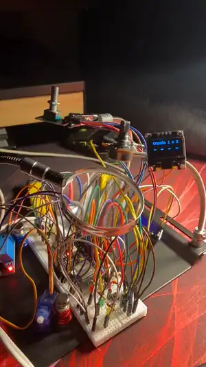

# Міні-проєкт 3: сейф із пін-кодом на енкодері

Міні-проєкт курсу Embedded Basic: пін-код вводиться енкодером, правильний код відкриває серво-замок, після трьох невдалих спроб сейф блокується.
Плата ESP32-S3-WROOM-1-N16R8, PlatformIO, Arduino.



Анімація — перші 20 с. Відео повністю, зі звуком (116 с): [demo.mp4](demo.mp4)

## Схема

Розводка на макетці: [map.svg](map.svg). На макетці стоять ще деталі інших домашок.

```
Енкодер KY-040: CLK -> GPIO7, DT -> GPIO8, SW -> GPIO9, + -> 3,3 В
Зумер: S -> GPIO15, живлення 3,3 В
Серво SG90: сигнал -> GPIO14, живлення 5 В із модуля живлення, земля спільна, 100 мкФ на шинах 5 В
Екран SSD1306, I2C: SDA -> GPIO10, SCK -> GPIO3, VDD -> 3,3 В
```

## Як вводити код

| Дія | Результат |
|---|---|
| оберт в один бік | цифра +1, після 9 знову 0 |
| зміна напрямку | цифра підтверджена, цей клац дає наступній цифрі 0 |
| кнопка | скинути набране, це теж спроба |
| кнопка, коли відкрито | закрити сейф |

Перший клац цифри дає 0. Після останньої цифри код перевіряється зміною напрямку. Код задається в `CODE` у `main.cpp`, для тесту 3 1 4 2.

Набране показується в консолі (цифра оновлюється через `\b`) і на екрані. Клавіша `?` у моніторі друкує стан.

## Як зроблено

- `safe.h`: машина станів без заліза, приймає клаци й натискання і повертає подію.
- `main.cpp`: залізо і реакція на події: консоль, серво, мелодії, екран.
- Енкодер читається в перериванні, бо оновлення екрана блокує `loop()` приблизно на 25 мс (розрахунок, не заміряв). Опитування могло б пропускати переходи.
- Серво і зумер на різних таймерах LEDC, бо мають різні частоти.

## Результат

- Правильний код: `ВІДКРИТО`, серво повертається, мелодія. Кнопка закриває сейф, спроби знову 3.
- Неправильний код і скидання витрачають спробу. Після третьої: `БЛОКУВАННЯ`, тривога, енкодер і кнопка не реагують до перезавантаження.
- 12 швидких клаців в один бік дали цифру 1, клаци не загубились. Екран працює і після вимкнення живлення.

Логіку `safe.h` окремо перевіряв тестом на комп'ютері, сам тест у цю папку не входить. Рефакторинг на задачі FreeRTOS поки не робив.

## Запуск

```
pio run -t upload -t monitor
```
